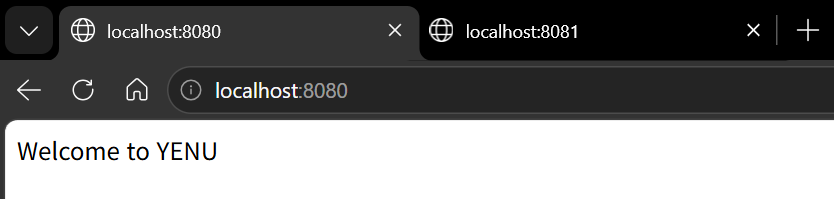
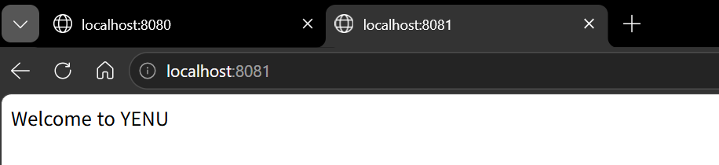
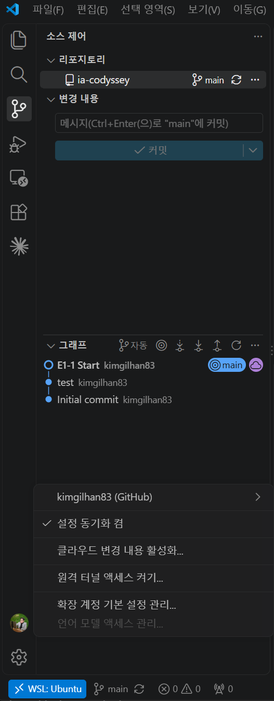
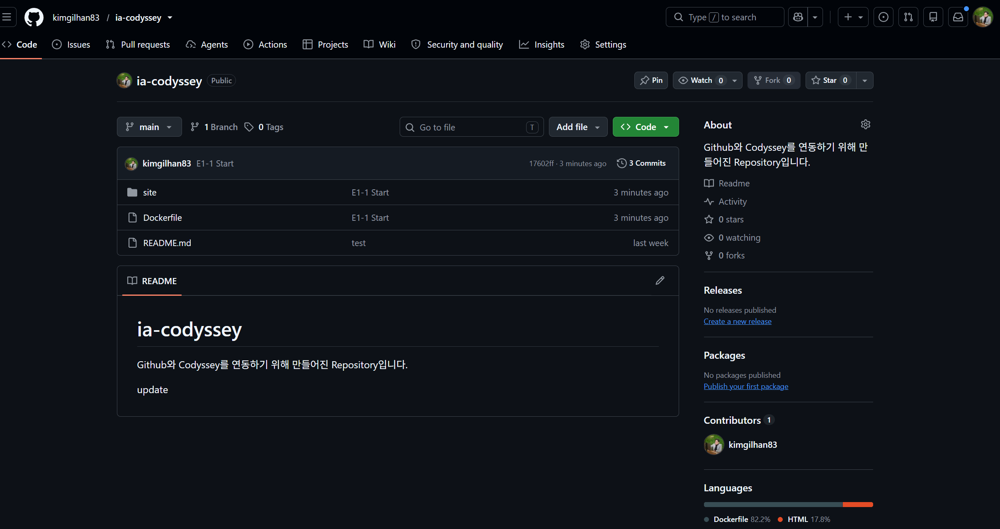

# E1-1 내 컴퓨터에 개발자용 '작업실' 꾸미기

> 경남 코디세이 AI 올인원 과정 미션 E1-1 제출 저장소
>

## 1. 프로젝트 개요

터미널(리눅스 CLI), Docker(컨테이너), Git/GitHub(버전 관리·협업)를 직접 세팅하고, 실행 결과(로그·접속·데이터 유지)로 동작을 검증한 기록입니다.

- 터미널로 작업 디렉토리를 만들고 파일 권한을 실습했습니다.
- Docker를 설치·점검하고 컨테이너를 실행·중지·관찰했습니다.
- nginx 기반 커스텀 이미지를 Dockerfile로 만들고 포트 매핑으로 접속을 확인했습니다.
- 바인드 마운트로 "변경 반영"을, 볼륨으로 "데이터 영속성"을 검증했습니다.
- Git을 설정하고 VSCode에서 GitHub 저장소와 연동했습니다.

## 2. 실행 환경

| 항목 | 내용 |
|---|---|
| 호스트 OS | Windows + WSL2 |
| 리눅스 배포판 | Ubuntu 26.04 LTS (resolute) |
| Shell | bash |
| 터미널 | Windows Terminal |
| Docker | Docker Desktop, Docker version 29.9.2 (WSL Integration 사용) |
| Git | git version 2.53.0 |
| 에디터 | VSCode (WSL 원격 연결) |

```bash
$ wsl -l -v          # PowerShell에서 실행
  NAME      STATE           VERSION
* Ubuntu    Running         2

$ lsb_release -a
No LSB modules are available.
Distributor ID: Ubuntu
Description:    Ubuntu 26.04 LTS
Release:        26.04
Codename:       resolute

$ echo $0
-bash

$ git --version
git version 2.53.0

$ docker --version
Docker version 29.9.2, build a82e528
```

## 3. 수행 체크리스트

- [x] 터미널 기본 조작 및 폴더 구성
- [x] 권한 변경 실습 (파일 1개, 디렉토리 1개)
- [x] Docker 설치 및 점검 (`--version`, `info`)
- [x] hello-world 실행
- [x] ubuntu 컨테이너 진입 및 명령 실행
- [x] Docker 운영 명령 (images, ps, logs, stats, stop)
- [x] attach / exec 차이 관찰
- [x] Dockerfile 기반 커스텀 이미지 빌드·실행
- [x] 포트 매핑 접속 (8080, 8081 2회)
- [x] 바인드 마운트 변경 반영
- [x] Docker 볼륨 영속성
- [x] Git 설정 (사용자 정보, 기본 브랜치)
- [x] VSCode GitHub 로그인 및 저장소 연동

## 4. 저장소 구조

```
ia-codyssey/
├── README.md        # 이 문서
├── Dockerfile       # 커스텀 nginx 이미지 레시피
├── site/
│   └── index.html   # 웹 서버가 보여줄 페이지
└── images/          # 증거 스크린샷
```

---

## 5. 수행 로그

### 5.1 터미널 기본 조작

```bash
$ pwd
/home/kimgilhan83
$ cd codyssey
$ pwd
/home/kimgilhan83/codyssey

# 숨김 파일 포함 목록 (홈 디렉토리)
$ cd
$ ls -la
total 36
drwxr-x--- 5 kimgilhan83 kimgilhan83 4096 Nov  5 10:05 .
drwxr-xr-x 3 root        root        4096 Nov  5 09:43 ..
-rw------- 1 kimgilhan83 kimgilhan83   88 Nov  5 10:05 .bash_history
-rw-r--r-- 1 kimgilhan83 kimgilhan83  220 Nov  5 09:43 .bash_logout
-rw-r--r-- 1 kimgilhan83 kimgilhan83 3771 Nov  5 09:43 .bashrc
drwxr-x--- 4 kimgilhan83 kimgilhan83 4096 Nov  5 09:44 .cache
drwxr-x--- 3 kimgilhan83 kimgilhan83 4096 Nov  5 09:44 .config
-rw-r--r-- 1 kimgilhan83 kimgilhan83    0 Nov  5 09:44 .motd_shown
-rw-r--r-- 1 kimgilhan83 kimgilhan83  807 Nov  5 09:43 .profile
drwxr-xr-x 3 kimgilhan83 kimgilhan83 4096 Nov  5 11:17 codyssey

# 생성, 이동, 빈 파일, 내용 확인
$ cd codyssey
$ mkdir practice
$ cd practice
$ touch menu.txt
$ echo "Kimchi Stew" > menu.txt
$ cat menu.txt
Kimchi Stew

# 복사
$ cp menu.txt menu_backup.txt
$ ls -a
.  ..  menu.txt  menu_backup.txt

# 이름 변경
$ mv menu_backup.txt menu_old.txt
$ ls
menu.txt  menu_old.txt

# 다른 폴더로 이동
$ mkdir archive
$ mv menu_old.txt archive/
$ ls
archive  menu.txt

# 삭제 후 확인
$ rm archive/menu_old.txt
$ cd archive
$ ls
$
```

**작업 위치 선택:** 실습 폴더를 Windows 드라이브(`/mnt/c/...`)가 아닌 리눅스 홈(`~/codyssey`)에 두었습니다. NTFS 위에서는 `chmod`가 기대대로 적용되지 않을 수 있고, Docker 바인드 마운트도 리눅스 파일시스템 쪽이 더 빠르고 안정적이기 때문입니다.

### 5.2 권한 실습

```bash
$ ls -l
total 8
drwxr-xr-x 2 kimgilhan83 kimgilhan83 4096 Nov  5 11:19 archive     # 755
-rw-r--r-- 1 kimgilhan83 kimgilhan83   12 Nov  5 11:17 menu.txt    # 644

# 파일: 주인만 읽기/쓰기
$ chmod 600 menu.txt
$ ls -l menu.txt
-rw------- 1 kimgilhan83 kimgilhan83 12 Nov  5 11:17 menu.txt

# 디렉토리: 주인만 읽기/쓰기/출입
$ chmod 700 archive
$ ls -ld archive
drwx------ 2 kimgilhan83 kimgilhan83 4096 Nov  5 11:19 archive
```

| 대상 | 변경 전 | 변경 후 | 목적 |
|---|---|---|---|
| `menu.txt` | `-rw-r--r--` (644) | `-rw-------` (600) | 다른 사용자가 내용을 볼 수 없게 함 |
| `archive/` | `drwxr-xr-x` (755) | `drwx------` (700) | 다른 사용자가 목록을 보거나(r) 안으로 들어오지(x) 못하도록 주인 전용으로 제한 |

- `ls -ld`의 `-d`는 디렉토리 **안의 내용물**이 아니라 **디렉토리 자체**의 권한을 보여줍니다.
- 실제 예시: `.bash_history`는 처음부터 600입니다. 명령 기록은 본인만 봐야 하기 때문입니다.

### 5.3 Docker 설치 및 점검

```bash
$ docker --version
Docker version 29.9.2, build a82e528

$ docker info      # 발췌
Client:
 Version:    29.9.2
 Context:    default
 ...
Server:
 Containers: 1
  Running: 0
  Paused: 0
  Stopped: 1
 Images: 1
 Server Version: 29.9.2
 Storage Driver: overlayfs
 ...
 Kernel Version: 6.6.114.1-microsoft-standard-WSL2
 Operating System: Docker Desktop
 OSType: linux
 Architecture: x86_64
 CPUs: 14
 Total Memory: 10.7GiB
 Name: docker-desktop
 ID: [MASKED]
 ...
```

`Server:` 항목이 출력되었으므로 Docker 데몬이 정상 동작 중입니다.

### 5.4 컨테이너 실행 실습

**hello-world**

```bash
$ docker run hello-world
Unable to find image 'hello-world:latest' locally
latest: Pulling from library/hello-world
4f55086f7dd0: Pull complete
d5e71e642bf5: Download complete
Digest: sha256:c567b231f65614688711a75f31518a064258a51d442117a3e771a3a8fdba78ef
Status: Downloaded newer image for hello-world:latest

Hello from Docker!
This message shows that your installation appears to be working correctly.
...

$ docker run hello-world      # 두 번째 실행: 다운로드 과정 없음

Hello from Docker!
...
```

두 번째 실행에서는 다운로드가 없었습니다. Docker는 먼저 **로컬에 이미지가 있는지 확인**하고, 있으면 그 이미지로 **새 컨테이너만** 만듭니다. 이미지는 한 번 받고, 컨테이너는 실행할 때마다 새로 생성됩니다.

**ubuntu 컨테이너 진입**

```bash
$ docker run -it ubuntu bash
Unable to find image 'ubuntu:latest' locally
latest: Pulling from library/ubuntu
...
Status: Downloaded newer image for ubuntu:latest
root@2ad7b80206f0:/# ls
bin  boot  dev  etc  home  lib  lib64  media  mnt  opt  proc  root  run  sbin  srv  sys  tmp  usr  var
root@2ad7b80206f0:/# ls -la
total 60
drwxr-xr-x   1 root root 4096 Nov  8 06:32 .
drwxr-xr-x   1 root root 4096 Nov  8 06:32 ..
-rwxr-xr-x   1 root root    0 Nov  8 06:32 .dockerenv
...
root@2ad7b80206f0:/# exit

$ docker run -it ubuntu bash
root@49f75f89d579:/# echo "YENU"
YENU
```

- 프롬프트가 `root@<컨테이너 ID>`로 바뀌어 컨테이너 내부임을 확인했습니다.
- `.dockerenv` 파일은 컨테이너 내부라는 표식입니다.
- `docker run`을 할 때마다 컨테이너 ID가 달라집니다(`2ad7b80206f0` → `49f75f89d579`). 같은 이미지로 새 컨테이너가 생성되기 때문입니다.

### 5.5 Docker 운영 명령

**이미지 목록**

```bash
$ docker images
IMAGE                ID             DISK USAGE   CONTENT SIZE   EXTRA
hello-world:latest   c567b231f656       25.9kB         9.49kB    U
nginx:latest         165ddde8751e        243MB         66.8MB    U
ubuntu:latest        6a06111c3b0a        163MB         45.9MB    U
```

`U`(In Use)는 해당 이미지로 만든 컨테이너가 (중지 상태라도) 남아 있다는 뜻입니다.

**실행 / 로그 / 리소스 / 중지**

```bash
$ docker run -d --name test-web nginx

$ docker logs test-web        # 발췌
/docker-entrypoint.sh: Configuration complete; ready for start up
2026/11/08 07:58:32 [notice] 1#1: nginx/1.31.8
2026/11/08 07:58:32 [notice] 1#1: start worker processes
2026/11/08 07:58:32 [notice] 1#1: start worker process 29
...
2026/11/08 07:58:32 [notice] 1#1: start worker process 42
2026/11/08 08:18:56 [notice] 1#1: signal 3 (SIGQUIT) received, shutting down
...
2026/11/08 08:18:56 [notice] 1#1: exit

$ docker stats test-web
CONTAINER ID   NAME       CPU %     MEM USAGE / LIMIT    MEM %     NET I/O        BLOCK I/O        PIDS
aa04fb2ffb84   test-web   0.00%     10.66MiB / 10.7GiB   0.10%     1.3kB / 126B   389kB / 1.45MB   15

$ docker stop test-web
test-web

$ docker ps
CONTAINER ID   IMAGE     COMMAND   CREATED   STATUS    PORTS     NAMES

$ docker ps -a
CONTAINER ID   IMAGE         COMMAND                  CREATED          STATUS                      PORTS     NAMES
615f1642fea4   ubuntu        "/bin/bash"              13 minutes ago   Exited (0) 11 minutes ago             box
aa04fb2ffb84   nginx         "/docker-entrypoint.…"   20 minutes ago   Exited (0) 16 seconds ago             test-web
49f75f89d579   ubuntu        "bash"                   2 hours ago      Exited (0) 2 hours ago                heuristic_engelbart
2ad7b80206f0   ubuntu        "bash"                   2 hours ago      Exited (127) 2 hours ago              musing_meninsky
59d97be342ba   hello-world   "/hello"                 2 hours ago      Exited (0) 2 hours ago                modest_bartik
606c3fa2da28   hello-world   "/hello"                 2 hours ago      Exited (0) 2 hours ago                cranky_dubinsky
```

- `docker ps`는 **실행 중인** 컨테이너만, `docker ps -a`는 **중지된 컨테이너까지 전부** 보여줍니다.
- worker process가 14개(29~42번)인 것은 `docker info`의 `CPUs: 14`와 일치합니다. nginx가 CPU 수에 맞춰 일꾼 수를 자동 조정했습니다.
- `docker stop` 시각(08:18:56)에 로그에 `SIGQUIT`이 찍히고, worker들이 `gracefully shutting down` 후 종료되었습니다. 그래서 `Exited (0)`(정상 종료)입니다.
- `--name`을 주지 않은 컨테이너는 `heuristic_engelbart`처럼 무작위 이름이 붙습니다.

### 5.6 attach와 exec 차이

예측: exec로 들어갔다 나오면 컨테이너는 꺼지지 않을 것이다.

```bash
$ docker run -d -it --name box ubuntu
$ docker start box
box

# exec: 새 bash를 띄워 진입
$ docker exec -it box bash
root@615f1642fea4:/# echo yaho
yaho
root@615f1642fea4:/# exit
$ docker ps
CONTAINER ID   IMAGE     COMMAND       CREATED          STATUS              PORTS     NAMES
615f1642fea4   ubuntu    "/bin/bash"   21 minutes ago   Up About a minute             box

# attach: 메인 bash에 직접 연결
$ docker attach box
root@615f1642fea4:/# echo mam
mam
root@615f1642fea4:/# exit
$ docker ps -a
CONTAINER ID   IMAGE         COMMAND       CREATED          STATUS                      PORTS     NAMES
615f1642fea4   ubuntu        "/bin/bash"   22 minutes ago   Exited (0) 10 seconds ago             box
```

| 방법 | exit 후 상태 | 이유 |
|---|---|---|
| `exec` | 유지 (`Up`) | 별도의 bash 프로세스를 새로 실행하므로, 그것만 종료됨 |
| `attach` | 종료 (`Exited`) | 메인 프로세스(`/bin/bash`)에 연결하므로, exit 시 메인 프로세스가 끝나 컨테이너도 종료됨 |

attach 중 컨테이너를 끄지 않고 빠져나오려면 `Ctrl+P` → `Ctrl+Q`를 사용합니다.

### 5.7 Dockerfile 기반 커스텀 이미지

**선택한 방식:** (A) 웹 서버 베이스 이미지(`nginx:alpine`) + 정적 콘텐츠 교체

```dockerfile
FROM nginx:alpine
LABEL maintainer="kimgilhan83"
ENV APP_VERSION=1.0
COPY ./site/index.html /usr/share/nginx/html/index.html
```

| 줄 | 목적 |
|---|---|
| `FROM nginx:alpine` | 웹 서버 실행을 위해 가볍고 빠른 nginx Alpine 이미지를 기반으로 사용 |
| `LABEL` | 이미지 작성자 정보를 명시하여 관리를 용이하게 함 |
| `ENV` | 애플리케이션 버전 정보를 환경 변수로 관리 |
| `COPY` | 로컬에서 작성한 HTML 파일을 nginx 기본 웹 콘텐츠 경로로 넣어 화면에 표시 |

**빌드**

```bash
$ docker build -t my-web-site:v1 .
[+] Building 1.7s (8/8) FINISHED                                             docker:default
 => [internal] load build definition from Dockerfile                                   0.0s
 => [internal] load metadata for docker.io/library/nginx:alpine                        1.2s
 => [1/2] FROM docker.io/library/nginx:alpine@sha256:713fc2ebfd92e8217db451477182ee91  0.1s
 => CACHED [2/2] COPY ./site/index.html /usr/share/nginx/html/index.html               0.0s
 => exporting to image                                                                 0.2s
 => => exporting config sha256:726267ebce4ad5648bc13d2a8927bf0e1fd8cd6c2ea8efc31b2868  0.0s
 => => naming to docker.io/library/my-web-site:v1                                      0.0s
```

같은 Dockerfile과 파일로 먼저 빌드했던 `my-app:v2.0`과 config sha256(`726267eb...`)이 같습니다. 같은 재료로 빌드하면 같은 이미지가 나온다는 **재현성**의 증거입니다.

**실행 및 포트 매핑 접속 (2회)**

```bash
$ docker run -d -p 8080:80 --name web1 my-web-site:v1
ba85f730f5cdb2d1e6c7ba75db7c8f9892502db4221d64c702d866618804f784
$ docker run -d -p 8081:80 --name web2 my-web-site:v1
1ed75755193a97d39d4cc76d484bbf8b4cc980fa9470d6cc02c36ffa5c34f5bd

$ curl http://localhost:8080
Welcome to YENU
$ curl http://localhost:8081
Welcome to YENU
```





`-p 바깥포트:안쪽포트` 형식입니다. 컨테이너 안의 nginx는 80번에서 요청을 받으므로, 호스트의 8080·8081을 컨테이너의 80으로 연결했습니다.

**네트워크 네임스페이스와 포트 매핑의 관계**

컨테이너는 리눅스 커널의 **네트워크 네임스페이스**로 격리된 자기만의 네트워크 공간(네트워크 인터페이스, IP 주소, 포트 번호 공간)을 가집니다. 그래서 위 실습에서 `web1`과 `web2`는 **둘 다 컨테이너 안쪽 80번**을 쓰는데도 충돌하지 않았습니다. 각 80번이 서로 다른 네임스페이스에 있기 때문입니다.

반대로 호스트 쪽 포트는 하나의 공간을 함께 쓰므로 **바깥 포트는 서로 달라야** 합니다(8080, 8081). 격리된 컨테이너 내부 포트는 외부에서 직접 접근할 수 없기 때문에, 호스트 포트를 컨테이너 포트로 연결해 주는 포트 매핑(포트 포워딩)이 필요합니다.

### 5.8 바인드 마운트: 변경 반영

`site` 폴더 안에서 실행했습니다.

```bash
$ cd ~/codyssey/ia-codyssey/site
$ docker run -d -p 8083:80 --name web-mount -v $(pwd):/usr/share/nginx/html nginx

# 변경 전
$ curl http://localhost:8083
Welcome to YENU

# 호스트에서 index.html 수정 (재빌드 없음)
$ nano index.html

# 변경 후
$ curl http://localhost:8083
Welcome to YENU & Codyssey

# 비교: COPY로 이미지에 넣은 컨테이너는 그대로
$ curl http://localhost:8080
Welcome to YENU
```

- 8083(바인드 마운트)은 재빌드 없이 즉시 반영되었고, 8080(COPY로 빌드 시점에 복사)은 바뀌지 않았습니다.
- 순정 `nginx` 이미지를 썼는데도 예누 문구가 보였습니다. 마운트가 이미지 안의 원래 폴더(nginx 기본 페이지)를 덮어서 가렸기 때문입니다.

### 5.9 Docker 볼륨: 데이터 영속성

```bash
# 볼륨 생성 및 확인
$ docker volume create my-data-vol
my-data-vol
$ docker volume ls
DRIVER    VOLUME NAME
local     my-data-vol

# 볼륨 연결 + 계속 실행 상태 유지
$ docker run -d --name ubuntu-test -v my-data-vol:/data ubuntu sleep infinity

# 데이터 쓰기 및 확인
$ docker exec ubuntu-test sh -c "echo '볼륨에 저장된 데이터입니다' > /data/test.txt"
$ docker exec ubuntu-test cat /data/test.txt
볼륨에 저장된 데이터입니다

# 컨테이너 삭제
$ docker rm -f ubuntu-test
ubuntu-test

# 새 컨테이너에 같은 볼륨 연결 후 확인 (--rm: 확인 후 자동 삭제)
$ docker run --rm -v my-data-vol:/data ubuntu cat /data/test.txt
볼륨에 저장된 데이터입니다
```

컨테이너 안에서 만든 파일은 컨테이너 전용 쓰기 공간에 저장되어 컨테이너 삭제 시 함께 사라집니다. 볼륨은 컨테이너 바깥에서 Docker가 관리하는 저장소이므로 컨테이너가 삭제되어도 데이터가 유지됩니다.

### 5.10 Git 설정 및 GitHub 연동

**Git 설정**

```bash
$ git config --global init.defaultBranch main
$ git config --global --list
user.name=kimgilhan83
user.email=[MASKED]
credential.https://github.com.helper=
credential.https://github.com.helper=!/usr/bin/gh auth git-credential
credential.https://gist.github.com.helper=
credential.https://gist.github.com.helper=!/usr/bin/gh auth git-credential
push.default=simple
branch.autosetupmerge=simple
init.defaultbranch=main
```


**로컬 저장소와 첫 커밋**

```bash
$ git init
Initialized empty Git repository in /home/kimgilhan83/codyssey/ia-codyssey/.git/
$ git status
On branch main

No commits yet

Untracked files:
        Dockerfile
        README.md
        site/

$ git add .
$ git status
Changes to be committed:
        new file:   Dockerfile
        new file:   README.md
        new file:   site/index.html

$ git commit -m "E1-1 Start"
[main (root-commit) 70e6bba] E1-1 Start
 3 files changed, 5 insertions(+)
 create mode 100644 Dockerfile
 create mode 100644 README.md
 create mode 100644 site/index.html
```

`create mode 100644`의 `644`는 5.2에서 실습한 권한 표기와 같습니다. Git도 파일 권한을 기록합니다.

**원격 저장소 푸시** (과정은 트러블슈팅 7.1 참고)

```bash
$ git push -u ia-codyssey main
...
To https://github.com/kimgilhan83/ia-codyssey.git
   ea11bb7..17602ff  main -> main
branch 'main' set up to track 'ia-codyssey/main'.

$ git log --oneline
17602ff (HEAD -> main, ia-codyssey/main, ia-codyssey/HEAD) E1-1 Start
ea11bb7 test
a1457f5 Initial commit
```

**VSCode GitHub 연동 증거**




- VSCode 왼쪽 아래 `WSL: Ubuntu`로 WSL 원격 연결 확인
- 계정 메뉴에 `kimgilhan83 (GitHub)` 로그인 확인
- 소스 제어 그래프의 `main` 옆 구름 아이콘으로 원격 동기화 확인

---

## 6. 검증 방법 요약

| 항목 | 명령 | 확인한 것 | 증거 위치 |
|---|---|---|---|
| 터미널 조작 | `pwd`, `ls -la`, `cp`, `mv`, `rm` | 파일 생성·복사·이동·삭제 결과 | 5.1 |
| 권한 | `chmod`, `ls -l`, `ls -ld` | 변경 전/후 권한 문자열 | 5.2 |
| Docker 동작 | `docker --version`, `docker info` | 버전, Server 항목 출력 | 5.3 |
| 컨테이너 실행 | `docker run hello-world`, `docker run -it ubuntu bash` | 성공 메시지, 내부 명령 실행 | 5.4 |
| 운영 | `docker images`, `ps -a`, `logs`, `stats`, `stop` | 상태 변화, 로그, 리소스 | 5.5 |
| attach/exec | `docker attach`, `docker exec`, `docker ps` | exit 후 Up/Exited 차이 | 5.6 |
| 커스텀 이미지 | `docker build`, `docker run -p` | 빌드 성공, 컨테이너 실행 | 5.7 |
| 포트 매핑 | `curl localhost:8080/8081`, 브라우저 | 응답 문구, 주소창 포트 | 5.7, 스크린샷 |
| 바인드 마운트 | `curl` 변경 전/후 | 재빌드 없이 반영 | 5.8 |
| 볼륨 | `docker volume`, `rm -f` 후 재확인 | 삭제 후에도 데이터 유지 | 5.9 |
| Git/GitHub | `git config --list`, `git log`, VSCode | 설정값, 커밋 이력, 로그인 | 5.10, 스크린샷 |

---

## 7. 트러블슈팅

### 7.1 GitHub 푸시 거부 (non-fast-forward, unrelated histories)

- **문제:** `git push` 시 `! [rejected] main -> main (non-fast-forward)` 발생
- **원인 가설 1:** 원격에 내가 없는 커밋이 있다. → `git pull` 시도
  - 결과: `Need to specify how to reconcile divergent branches` (병합 방식 지정 필요)
- **원인 가설 2:** merge로 합치면 된다. → `git pull --no-rebase`
  - 결과: `fatal: refusing to merge unrelated histories`
  - 확인: GitHub 저장소가 지난주에 이미 만들어져 `Initial commit`, `test` 커밋이 있었고, 로컬은 `git init`으로 따로 만들어 **공통 조상이 없었음**
- **해결:** `git pull --rebase`로 로컬 커밋을 원격 이력 끝에 다시 쌓은 뒤 푸시 성공
  - 이 과정에서 커밋 번호가 `70e6bba` → `17602ff`로 바뀜. 커밋 번호는 "직전 커밋"까지 포함해 계산되기 때문
- **재발 방지:** GitHub에 저장소가 이미 있다면 `git init`으로 새로 만들지 않고 `git clone`으로 원격 저장소를 받아서 시작한다. 그러면 처음부터 같은 이력을 공유하므로 이 문제가 생기지 않는다.

### 7.2 컨테이너 이름 충돌

- **문제:** `docker run --name web1 ...` 실행 시 `Conflict. The container name "/web1" is already in use`
- **원인 가설:** 같은 이름의 컨테이너가 아직 있다.
- **확인:** `docker ps`에는 없지만 `docker ps -a`에 `Exited` 상태로 남아 있었음. **중지된 컨테이너도 이름을 계속 점유**함
- **해결:** `docker rm -f web1`로 삭제 후 재실행
- **관련 오류:** 실행 중인 컨테이너를 `docker rm` 하면 `container is running: stop the container before removing` 발생 → `docker stop` 후 삭제하거나 `-f` 사용

### 7.3 Dockerfile 파싱 오류

- **문제 1:** `dockerfile parse error on line 3: unknown instruction: ENV=VERSION`
  - **원인:** 구형 문법 `ENV APP_VERSION 1.0`을 고치면서 `=`를 키와 값 사이가 아닌 `ENV` 바로 뒤에 붙임
  - **해결:** `ENV APP_VERSION=1.0`
- **문제 2:** `unexpected end of statement while looking for matching double-quote`
  - **원인:** LABEL에서 이메일을 지우다가 닫는 따옴표까지 지움
  - **해결:** `LABEL maintainer="kimgilhan83"`로 따옴표 짝을 맞춤
- **교훈:** 빌드 오류 메시지가 문제 줄을 `>>>`로 정확히 가리켜 주므로, 해당 줄부터 확인

### 7.4 (참고) 기타 관찰

- `docker run -it ubuntu bash` 안에서 `q` 오타 후 `exit` → 해당 컨테이너가 `Exited (127)`로 기록됨. 숫자 없는 `exit`는 마지막 명령의 종료 코드(127 = command not found)를 그대로 가지고 나감
- 빈 `index.html`로 빌드했을 때 브라우저에 하얀 화면 → 포트 연결은 성공했지만 보여줄 내용이 없었던 것. COPY는 빌드 시점의 파일을 넣으므로 내용 수정 후 **재빌드**로 해결
- `touch DockerFile`과 `nano Dockerfile`로 파일이 두 개 생김 → 리눅스는 대소문자를 구분함. Docker 기본값인 `Dockerfile`만 남김
- 존재하지 않는 태그(`my-web-site:v2`)로 실행 → `pull access denied`. 로컬에 없으면 Docker Hub에서 찾으려 하기 때문

---

## 8. 개념 정리

| 개념 | 설명 |
|---|---|
| 절대 경로 vs 상대 경로 | 절대 경로는 `/`부터 시작해 어디서 실행해도 같은 곳을 가리키고, 상대 경로는 현재 위치 기준이라 실행 위치에 따라 결과가 달라진다. 예: 홈에서 `cd practice`는 실패, `cd ~/codyssey/practice`는 성공 |
| 권한 r/w/x, 755·644 | r=4, w=2, x=1을 주인·그룹·기타 순으로 더한 값. 644 = `rw-r--r--`, 755 = `rwxr-xr-x`. 디렉토리의 x는 "들어갈 수 있는 권한" |
| 이미지 vs 컨테이너 | 이미지는 실행 설계도(한 번 받아 재사용), 컨테이너는 그 이미지로 만든 실행 단위(실행할 때마다 새로 생성) |
| 커스텀 이미지 | 기존 베이스 이미지(`FROM`) 위에 내 설정·파일을 얹어 새 이미지를 만드는 것 |
| 네트워크 네임스페이스 | 리눅스 커널이 컨테이너마다 독립된 네트워크 공간(인터페이스·IP·포트)을 만들어 주는 격리 기능. 그래서 여러 컨테이너가 안쪽에서 같은 포트(예: 80)를 동시에 쓸 수 있다 |
| 포트 매핑 | 네임스페이스로 격리된 컨테이너 포트는 외부에서 직접 접근할 수 없으므로, 호스트 포트를 컨테이너 포트에 연결해야 한다. 호스트 포트는 서로 겹치면 안 되고, 오른쪽(컨테이너 포트)은 프로그램이 실제로 듣는 포트여야 한다 |
| 바인드 마운트 vs 볼륨 | 바인드 마운트는 호스트 폴더를 그대로 연결(개발 중 즉시 반영), 볼륨은 Docker가 관리하는 저장소(데이터 영속성) |
| Git vs GitHub | Git은 내 컴퓨터의 버전 관리 도구, GitHub는 Git 저장소를 올려 공유·협업하는 원격 플랫폼 |

---

## 9. 재현 시 주의사항

- **WSL 환경 기준:** Windows + WSL2 + Docker Desktop(WSL Integration 켬)에서 수행했습니다. 리눅스 네이티브 환경에서는 Docker Engine을 직접 설치하면 됩니다.
- **바인드 마운트 경로:** 5.8의 `$(pwd)`는 `site` 폴더 안에서 실행해야 합니다. 저장소 최상위에서 실행할 경우 `-v $(pwd)/site:/usr/share/nginx/html`로 바꿉니다.
- **현재 index.html 내용:** 바인드 마운트 실습에서 수정했기 때문에 지금 저장소의 `index.html`은 `Welcome to YENU & Codyssey`입니다. 지금 빌드하면 5.7과 다른 문구가 나옵니다.
- **포트 충돌:** 8080~8083을 다른 프로그램이 쓰고 있으면 실행이 실패합니다. 아래 9.1 절차로 진단·해제하거나 다른 포트로 바꿔 실행합니다.
- **개인 경로:** 로그의 `/home/kimgilhan83`은 작성자 환경의 홈 경로입니다. 재현 시 본인의 홈 경로(`~`)로 바꿔 읽으면 됩니다.
- **원격 이름:** 이 저장소는 원격 별명을 `origin` 대신 `ia-codyssey`로 등록했습니다.

### 9.1 포트 충돌 진단·해제 절차

> 이번 실습 중에는 실제 포트 충돌이 발생하지 않아, 실행 로그 없이 대응 절차만 정리했습니다.

**1단계. 증상 확인**
`docker run -p 8080:80 ...` 실행 시 "포트가 이미 할당됨(port is already allocated)" 계열의 오류가 나면 호스트의 8080을 누군가 쓰고 있다는 뜻입니다.

**2단계. 점유자 찾기 (진단)**

```bash
# (1) Docker 컨테이너가 점유 중인지 확인
docker ps --filter "publish=8080"
docker port <컨테이너이름>

# (2) 리눅스(WSL) 프로세스가 점유 중인지 확인
ss -ltnp | grep 8080          # -l 대기 중, -t TCP, -n 숫자 표시, -p 프로세스 표시
sudo lsof -i :8080            # lsof가 설치된 경우
```

```powershell
# (3) Windows 프로세스가 점유 중인지 확인 (PowerShell)
netstat -ano | findstr :8080          # 맨 끝 숫자가 PID
tasklist /FI "PID eq <PID>"           # PID로 프로그램 이름 확인
```

Docker Desktop + WSL 환경에서는 컨테이너 포트가 Windows 쪽에서 열리므로, WSL의 `ss`에는 보이지 않을 수 있습니다. 이 경우 (1) Docker 명령이나 (3) Windows 명령으로 확인합니다.

**3단계. 포트 해제**

| 점유자 | 해제 방법 |
|---|---|
| Docker 컨테이너 | `docker stop <이름>` 또는 `docker rm -f <이름>` |
| 리눅스 프로세스 | 프로그램 확인 후 `kill <PID>` |
| Windows 프로세스 | 프로그램 확인 후 `taskkill /PID <PID>` |
| 종료하면 안 되는 프로그램 | 내 컨테이너의 바깥 포트를 바꿈 (예: `-p 8090:80`) |

`kill`, `taskkill`은 어떤 프로그램인지 확인한 뒤에만 사용합니다.

**4단계. 재확인**
다시 `docker run`을 실행하고 `curl http://localhost:<포트>`로 응답을 확인합니다.

## 10. 보안 처리 내역

- `git config` 출력의 이메일 주소를 `[MASKED]` 처리
- `docker info`의 `ID` 값을 `[MASKED]` 처리
- Dockerfile `LABEL`에서 이메일 주소를 제거하고 GitHub 사용자명으로 대체
- 미션과 무관한 개인 작업 파일·명령 기록은 로그에서 제외
- 스크린샷에 토큰·비밀번호·인증 코드가 없음을 확인

